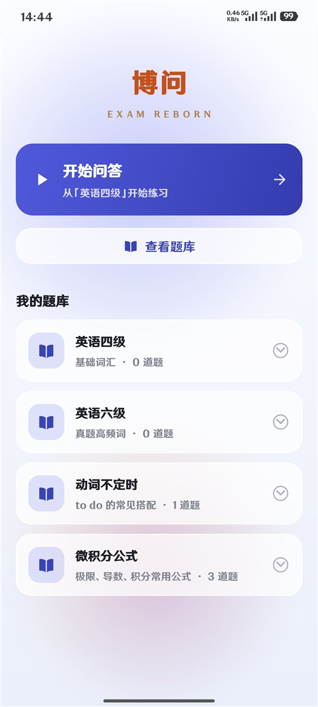
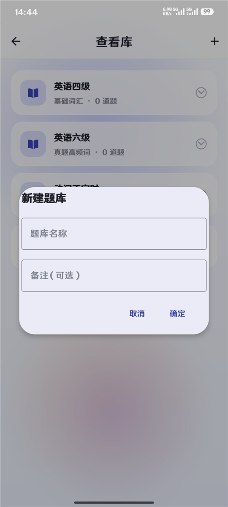

# 博问 · EXAM REBORN

一个完全离线的 Android 刷题 App：自己建题库、从文件批量导入试卷、按五种题型练习并记录解析。

---

## 它能做什么

- **五种题型**：单选、多选、判断、填空、简答（简答题不自动判分，只给参考答案）
- **题库管理**：新建/编辑/删除题库，题目可分类（章节、标签、难度 1~5、分值）
- **批量导入**：选一个 `txt` / `md` / `json` 文件，App 解析成题目，先在预览页里勾选、看统计和警告，再决定导入哪些
- **练习**：上一题/下一题、提交看对错、看解析、写笔记
- **完全离线**：`AndroidManifest.xml` 里没有任何网络权限，数据只存在本机 Room 数据库里

## 截图

| 首页 | 题库列表 |
|---|---|
|  |  |

> 练习页、导入预览页的截图待补（见 `docs/screenshots/`）。

## 技术要点

| 部分 | 做法 |
|---|---|
| 语言 / 构建 | Java 8、Gradle 8.7、AGP 8.6、`minSdk 33` / `targetSdk 34` |
| 数据 | Room 2.6（`AppDao` + `AppDatabase`），题库 / 题目两张表；题库列表用一条 `LEFT JOIN + COUNT` 拿题目数，避免逐行再查 |
| 解析 | `parse/PaperParser.java`：纯 Java、不依赖 Android API，可直接跑 JUnit |
| 编码 | `util/DocFileReader.java`：UTF-8 解码出现替换字符时回退 GBK（中文老文档常见） |
| 选项/答案 | `data/OptionCodec`、`data/AnswerCodec`：把多选、判断题的存储格式和业务格式分开 |
| UI | Material 3 + 自定义 drawable（渐变、玻璃卡片、深色主题 `values-night`） |

### 界面与页面跳转

6 个页面全部用 Activity（没有用 Fragment + 单 Activity 的方案，因为这个体量下 Activity 更直白）：

```
MainActivity（启动页 / 品牌动画）
└→ HomeActivity（首页：开始问答 / 查看题库 / 我的题库）
   ├→ BankListActivity（题库列表：新建 / 切换 / 进入）
   │    └→ EditQuestionActivity（新增题目）
   ├→ QaActivity（练习：题目 → 选项 → 提交 → 对错与解析）
   │    └→ EditQuestionActivity（编辑当前题）
   └→ ImportPreviewActivity（导入预览：识别统计 / 勾选 / 警告 / 导入）
```

界面层做的事：

- 界面元素基本用**自定义 shape drawable** 拼出来（渐变背景、玻璃卡片、按钮、输入框），没有引入 UI 图片资源
- Material 3 主题 + `values-night` 深色适配
- 列表用 `RecyclerView` + 自定义 Adapter，弹窗统一走 `dialog/AppDialogs`
- 用 `InsetUtils` / `GlassUtils` 处理状态栏内边距与毛玻璃效果

### 真正花时间的部分：试卷解析器

> 这一部分由 [@DBW176](https://github.com/DBW176) 实现，放在这里是为了说明项目的难点。

`PaperParser` 约 600 行，负责把"人写的试卷"变成结构化题目，支持两种输入：

1. **JSON 试卷**：`single` / `multi` / `judge` / `fill` / `essay` 五段
2. **Markdown / 纯文本**：`## 单选题` 分节、`A. B. C.` 选项、`答案：` / `解析：` / `难度：` 字段

难点不在写正则，而在**格式的边界**：

- 题干编号有 `1.`、`1、`、`(1)`、`第 1 题` 等多种写法
- 选项字母可能大小写混用，可能是 `A.` 也可能是 `A、`
- 一段文字到底算"上一题的解析"还是"下一题的题干"，要靠上下文判断
- 判断不了的不能瞎猜，要进 `warnings` 让用户在预览页看到

所以 `PaperParserTest` 里放了真实的 JSON 与 Markdown 样例，改解析逻辑必须先过测试。

## 目录结构

```
app/src/main/java/com/example/examreborn/
├── MainActivity / HomeActivity / BankListActivity   入口、首页、题库列表
├── QaActivity                                       练习页（答题、判分、笔记）
├── EditQuestionActivity                             题目编辑
├── ImportPreviewActivity                            导入预览与勾选
├── parse/PaperParser.java                           试卷解析（纯 Java）
├── data/                                            Room 实体、DAO、Codec、种子数据
├── model/                                           Question、QuestionBank
├── adapter/                                         列表适配器
├── dialog/                                          统一弹窗
└── util/                                            文件读取、格式化、内边距、玻璃效果
```

## 怎么跑

```bash
# 用 Android Studio 打开项目根目录，等 Gradle 同步完成
# 或者在命令行：
gradlew test        # 跑解析器单测，不需要手机/模拟器
gradlew assembleDebug
```

需要：Android SDK（`compileSdk 34`）、JDK 17（AGP 8.6 要求）、一台 Android 13+ 的设备或模拟器。

> `gradlew assembleDebug` 可以离线构建；`gradlew test` 首次需要联网下载 `org.json` 测试依赖。
> 构建产物在 `app/build/outputs/apk/debug/app-debug.apk`（约 12 MB，未签名，已 gitignore）。

## 已知不足

- 包名还是 `com.example.examreborn`（个人练习，没做发布准备）
- `minSdk 33`，老设备装不上
- 导入只支持 `txt` / `md` / `json`，**不支持 `.docx`**
- 没有导出/同步/备份，换手机数据就没了
- 没有 CI，测试靠本地 `gradlew test`
- 数据库没有写迁移，改表结构要清数据

## 背景

课程项目，和同学一起做的第一个 Android 应用。界面部分后来重做过一版（AI 辅助生成初稿，样式与交互自己调）。

**分工**：

- **我**（[@learn-programming-li](https://github.com/learn-programming-li)）：前端界面与页面跳转 —— 6 个 Activity 的布局、主题与样式（渐变 / 玻璃卡片 / 深色模式）、底部导航与页面切换、列表与弹窗交互、导入预览的勾选流程
- **DBW176**（[@DBW176](https://github.com/DBW176)）：后端数据与解析 —— Room 实体与 DAO、`PaperParser` 试卷解析器（约 600 行）、选项/答案编码、解析器单测

## License

MIT（如果你打算公开，建议保留这一段；不想被复用就删掉）
